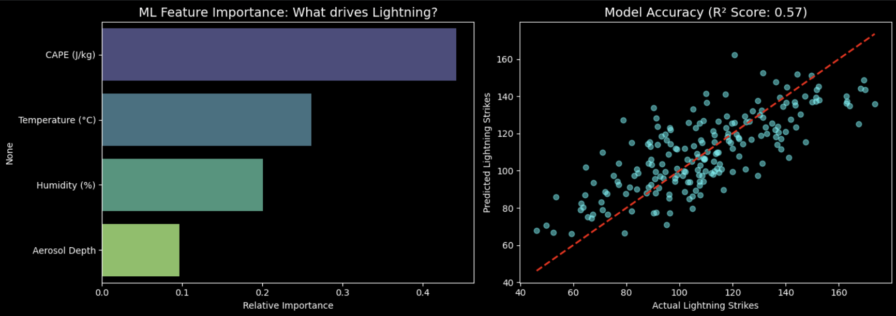

# Lightning Data Correlation & ML Showcase
**Note: This is a short Proof-of-Concept (PoC) demonstration project.**

## Why this was built
This repository was built specifically to accompany my application for the **Lightning and Interplanetary Dust Particle (IDP) Data Analysis Project** at PRL. 

Since the actual sensor telemetry and mission data are private, I built this mini-pipeline to demonstrate my readiness for the project's core scope: **using machine learning algorithms to find patterns, extract signals, and correlate them with physical phenomena.**

##  What this project does
This script simulates a machine learning pipeline that mirrors the data analysis process for physical atmospheric phenomena. 

Because cleaning raw meteorological data from scratch is highly time-consuming, this script generates a **physics-informed synthetic dataset** mimicking key atmospheric parameters:
*   **CAPE (Convective Available Potential Energy):** A measure of atmospheric instability.
*   **Aerosol Optical Depth:** Representing suspended particles/dust in the atmosphere.
*   **Temperature & Humidity:** Standard meteorological metrics.

It then trains a **Random Forest Regressor** to predict lightning frequency based on these physical parameters and extracts the feature importance to identify the strongest correlations.

## Results & Visualization
The model successfully filters through the atmospheric noise to identify which physical parameters have the highest correlation to the target signal. 

*(Include the generated graph here by uploading it to your repo)*

